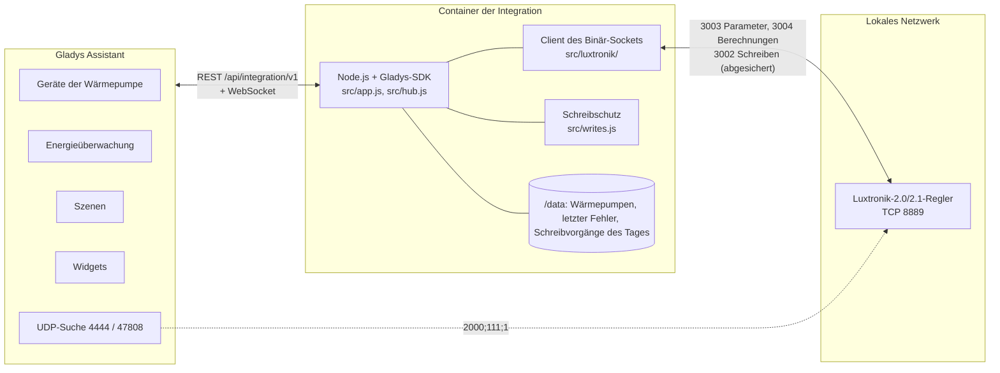
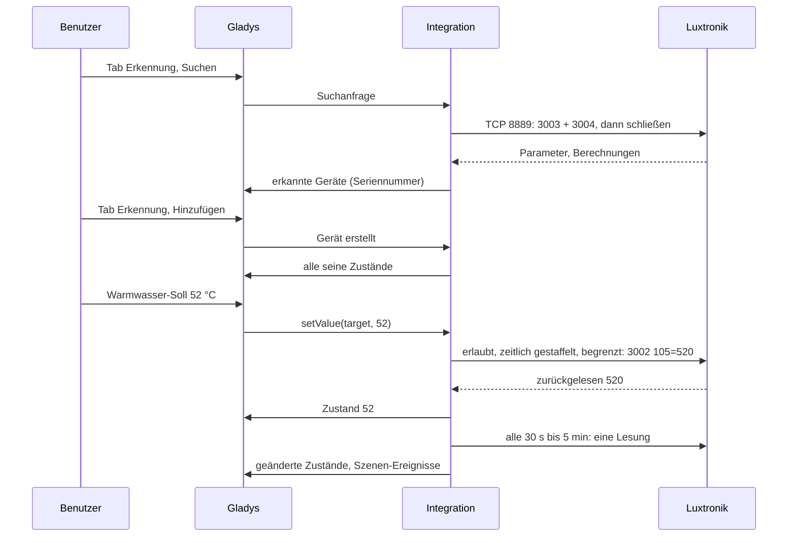
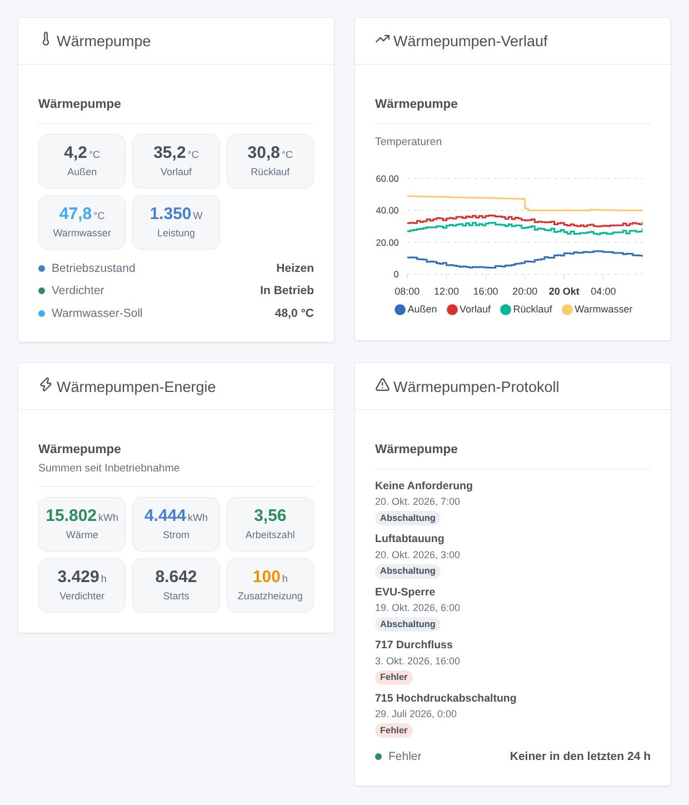

# Luxtronik für Gladys Assistant

[English](README.md) | [Français](README.fr.md) | **Deutsch** | [Español](README.es.md)

[](LICENSE)
[](https://github.com/William-De71/gladys-luxtronik/releases)
[](https://github.com/William-De71/gladys-luxtronik/actions/workflows/release.yml)
[](https://gladysassistant.com)


Ihre Wärmepumpe mit Luxtronik-2.0- oder -2.1-Regler (Alpha Innotec, Novelan, Siemens, Buderus, Nibe AP, Roth, Elco, Wolf…) in Gladys Assistant, im lokalen Netzwerk, ganz ohne Cloud. Temperaturen, Betriebsarten, Verdichter, Zusatzheizung, Fehler und Energie werden zu Gladys-Geräten, mit vier Widgets, Szenen-Auslösern und sorgfältig abgesicherten Änderungen. Inoffiziell, nicht mit Alpha Innotec verbunden.

## Funktionen

- **Lesen im lokalen Netzwerk** über den Binär-Socket des Reglers (TCP-Port 8889), den der Alpha-Innotec-Werkzeuge und der Home-Assistant-Integrationen: immer nur eine Verbindung, nach jeder Lesung geschlossen, alle 30 Sekunden bis 5 Minuten.
- **Bis zu vier Geräte pro Wärmepumpe**: die Wärmepumpe selbst (Temperaturen, Betriebszustand, Status, letzter Fehler, Verdichter, Zusatzheizung, Leistung und Energie, Zähler), Heizung (Betriebsart, Temperatur +/-), Warmwasser (Temperatur, Soll, Betriebsart) und Kühlung (ein / aus, Soll), jeweils nur, wenn die Wärmepumpe sie hat.
- **Änderungen standardmäßig aus**: Wenn erlaubt, lassen sich die Betriebsarten Heizung und Warmwasser, Temperatur +/-, das Warmwasser-Soll und die Kühlung ändern, in festen Grenzen, nie zweimal derselbe Wert, eine Einstellung höchstens alle 2 Minuten, höchstens 50 Änderungen pro Tag, nie auf der Firmware, die beim Schreiben abstürzt.
- **Energie für Gladys**: verbrauchter Strom (ein Zählerstand für die Energieüberwachung von Gladys), elektrische Leistung, Heizleistung und erzeugte Wärme, wenn der Regler sie liefert.
- **Vier Dashboard-Widgets**: was die Wärmepumpe gerade tut, ihre Temperaturverläufe, ihre Energie und Arbeitszahl, ihr Fehler- und Abschaltprotokoll.
- **Sechs Szenen-Auslöser** (Fehler, Wechsel des Betriebszustands einschließlich Abtauen, Zusatzheizung ein / aus, Wärmepumpe verloren / zurück) und **eine Szenen-Aktion** (Wärmepumpe auslesen).
- Die Seriennummer identifiziert die Wärmepumpe: Eine neue IP-Adresse wird verfolgt. Die Alpha-Innotec-Netzwerksuche wird über Gladys versucht.
- Englisch, Französisch, Deutsch und Spanisch.

## Funktionsweise




**Protokoll.** Der Regler antwortet auf TCP-Port 8889 mit 32-Bit-Ganzzahlen in Big-Endian: `3003` liefert die rund 1 100 Parameter (Einstellungen, im EEPROM gespeichert), `3004` die rund 270 Berechnungen (Messwerte und Zustände), `3002 <Index> <Wert>` schreibt einen Parameter. **Luxtronik 2.0 und 2.1 (Firmware V1.x, V2.x und V3.x) behalten beide diesen Port**: Die Home-Assistant-Integrationen und python-luxtronik nutzen ihn mit jeder Firmware. Der WebSocket der Weboberfläche (Port 8214, Passwort, XML) bietet nichts zusätzlich und wird nicht genutzt; ebenso wenig die Modbus-„Smart-Home-Schnittstelle“ neuer Firmware (Port 502, am Regler zu aktivieren).

**Erkennung.** Die eingegebenen Adressen werden immer gelesen. Die Integration lässt außerdem Gladys das Alpha-Innotec-Suchdatagramm auf UDP 4444 und 47808 senden (ein Container kann nicht ins lokale Netz broadcasten): Ein antwortender Regler wird ebenfalls gelesen. Die Referenzwerkzeuge senden es vom Zielport aus, Gladys von einem beliebigen Port: Möglicherweise antwortet nicht jede Firmware, daher die eingegebene Adresse.

**Schreiben.** Siehe [Einstellungen ändern](#konfiguration). Firmware V1.90.x und V2.90.x stürzt bei jedem Schreiben über Port 8889 ab (an BenPru/luxtronik gemeldet): Sie bleibt schreibgeschützt. Seit Nebenversion 88.3 folgt der Regler dem Warmwasser-Soll in Parameter 105, davor in Parameter 2: Die Integration schreibt und liest den richtigen.




### Geräte und Funktionen

| Gladys-Gerät                     | Wann                          | Funktionen                                                                                                                                                                                                                                                                                                                                                                                        |
| -------------------------------- | ----------------------------- | ------------------------------------------------------------------------------------------------------------------------------------------------------------------------------------------------------------------------------------------------------------------------------------------------------------------------------------------------------------------------------------------------- |
| `heatpump` — Wärmepumpe          | immer                         | Temperaturen `outdoor`, `outdoor_average`, `flow`, `return`, `return_target`, `hot_gas`, `source_in`, `source_out`, `room` (Raumbedieneinheit); Texte `operating_mode`, `status`, `last_error`; `compressor`, `backup_heater` (ein / aus); `power_input` (W), `energy_input` (Zählerstand kWh), `heat_output` (W), `heat_produced` (kWh); `compressor_hours`, `compressor_starts`, `backup_hours` |
| `heating` — Wärmepumpe – Heizung | immer                         | `mode` (Auswahl: Automatik, zweiter Wärmeerzeuger, Party, Ferien, aus), `offset` (Temperatur +/-, −5 bis +5 °C)                                                                                                                                                                                                                                                                                   |
| `dhw` — Wärmepumpe – Warmwasser  | die Pumpe bereitet Warmwasser | `temperature`, `target` (30 bis 65 °C), `mode` (Auswahl), `heating` (Bereitung läuft)                                                                                                                                                                                                                                                                                                             |
| `cooling` — Wärmepumpe – Kühlung | die Pumpe kann kühlen         | `enabled` (Kühlung Automatik ein / aus), `target` (18 bis 30 °C)                                                                                                                                                                                                                                                                                                                                  |

Leistungs- und Energiefunktionen erscheinen nur, wenn der Regler sie liefert (neue Firmware, Wärmemengenzähler). Externe IDs: `ext:<selector>:<Gerät>:<Seriennummer>` (Parameter 874 und 875), Funktionen `…:<Schlüssel>`.

## Transport

`transports: ["local"]`: Der Katalog zeigt das Badge **lokal**. Nichts verlässt das lokale Netzwerk: kein Konto, keine Cloud. Jedes Gerät meldet **lokal**, solange der Regler antwortet, sonst **nicht erreichbar**; es gibt weder eine lokale Präferenz noch einen eingeschränkten Modus.

## Widgets



Jedes Widget hat eine Einstellung **Wärmepumpe** (die erste, wenn leer).

- **Wärmepumpe** (`overview`): Außen-, Vorlauf-, Rücklauf- und Warmwassertemperatur, Leistungsaufnahme (oder Heizleistung), Betriebszustand, Status, Verdichter, Zusatzheizung wenn sie läuft, Warmwasser-Soll.
- **Wärmepumpen-Verlauf** (`history`, Einstellung `period`: 24 Stunden, 3 oder 7 Tage): Außen-, Vorlauf-, Rücklauf- und Warmwassertemperatur aus dem Verlauf von Gladys (die Geräte müssen hinzugefügt sein).
- **Wärmepumpen-Energie** (`energy`): erzeugte Wärme, verbrauchter Strom, Arbeitszahl (Wärme ÷ Strom seit Inbetriebnahme, wenn beide Zähler vorhanden sind), Stunden und Starts des Verdichters, Stunden der Zusatzheizung.
- **Wärmepumpen-Protokoll** (`log`): die letzten Fehler (Code und Bedeutung) und Verdichter-Abschaltungen (Grund) mit Datum, und ob in den letzten 24 Stunden ein Fehler auftrat.

## Szenen-Auslöser und -Aktionen

Auslöser (Filter `device`: eine Wärmepumpe, alle wenn leer):

- `error_occurred` — **Die Wärmepumpe meldet einen Fehler**: ein neuer Eintrag im Fehlerspeicher. Variablen: `device_name`, `error_code`, `error_text` (in der eingestellten Sprache).
- `mode_changed` — **Die Wärmepumpe wechselt den Betriebszustand**. Filter: `mode`, `previous_mode` (`heating`, `hot_water`, `pool`, `grid_lock`, `defrost`, `idle`, `external_heating`, `cooling`). Variablen: `device_name`, `mode_text`.
- `backup_heater_started` — **Die Zusatzheizung schaltet ein**. Variablen: `device_name`, `outdoor_temperature`.
- `backup_heater_stopped` — **Die Zusatzheizung schaltet aus**. Variablen: `device_name`, `run_minutes`.
- `heat_pump_offline` — **Die Wärmepumpe antwortet nicht mehr** (3 Minuten). Variablen: `device_name`, `address`.
- `heat_pump_online` — **Die Wärmepumpe antwortet wieder** (nach einem Verlust).

Aktion:

- `read_values` — **Wärmepumpe auslesen** (`device`): eine frische Lesung. Ausgaben `operating_mode`, `status`, `outdoor_temperature`, `flow_temperature`, `return_temperature`, `hot_water_temperature`, `hot_water_target`, `power_input_w`, `heat_output_w`, `last_error_code` (0: keiner), `last_error_text`.

Beispiele:

- **Die Wärmepumpe meldet einen Fehler** → eine Benachrichtigung „Wärmepumpe: {{triggerEvent.data.error_text}}“ senden.
- **Die Zusatzheizung schaltet ein** → eine Nachricht senden: Die Wärmepumpe nutzt ihren Heizstab, bitte prüfen.
- **Die Wärmepumpe wechselt den Betriebszustand**, `mode` = `defrost` → den Badlüfter jetzt nicht starten.

## Voraussetzungen

- Gladys Assistant **5.3.0 oder neuer** (Katalog-Suchbegriffe von Gladys 5.3, Dashboard-Widgets sowie Szenen-Auslöser und -Aktionen von Integrationen; ältere Instanzen können die Integration nicht installieren).
- Ein Luxtronik-2.0- oder -2.1-Regler, per Kabel mit dem Netzwerk verbunden, mit fester IP-Adresse (DHCP-Reservierung im Router).

## Installation

- **Aus dem Store**: Integrationen → „Luxtronik“ suchen → Installieren. Akzeptieren Sie die Netzwerkerkennung (UDP 4444 und 47808) im Installationsdialog.
- **Über die Repository-URL**: Integrationen → Integration installieren → `https://github.com/William-De71/gladys-luxtronik` einfügen.
- **Entwicklermodus**: Integrationen → Integration installieren → Entwicklermodus, mit dem Manifest eines Builds (die Zusammenfassung des Workflows „Build and publish image“ zeigt es).

## Konfiguration

| Feld             | Typ     | Standard | Bedeutung                                                                            |
| ---------------- | ------- | -------- | ------------------------------------------------------------------------------------ |
| `hosts`          | string  | leer     | IP-Adressen der Regler, durch Kommas getrennt; `:Port` nur, wenn nicht 8889          |
| `network_search` | boolean | `true`   | zusätzlich die Alpha-Innotec-Suche (UDP 4444 und 47808) über Gladys senden           |
| `poll_interval`  | select  | `60`     | Sekunden zwischen zwei Lesungen: 30, 60, 120, 300                                    |
| `allow_writes`   | boolean | `false`  | Änderungen erlauben (Betriebsarten, Temperatur +/-, Warmwasser-Soll, Kühlung)        |
| `language`       | select  | `en`     | Sprache der Funktionsnamen, der Betriebsarten, der Textzustände und der Szenenfehler |

Schutz bei Änderungen: ein bereits gesetzter Wert wird nie geschrieben; dieselbe Einstellung höchstens alle 2 Minuten; 50 Änderungen pro Tag und Wärmepumpe (gezählt in `/data/writes.json`); Grenzen: Warmwasser 30–65 °C, Temperatur +/- −5–+5 °C, Kühlung 18–30 °C, Schritte von 0,5 °C; der Wert wird zurückgelesen; nie Schreiben auf Firmware V1.90.x / V2.90.x.

Schaltfläche der Konfigurationsseite: **Wärmepumpen suchen und testen** (liest die Adressen und sucht im Netzwerk, listet jede Wärmepumpe mit Adresse, Firmware, Seriennummer und Änderbarkeit auf).

## Verwendung

1. Installieren Sie die Integration, geben Sie die IP-Adresse des Reglers ein und drücken Sie **Wärmepumpen suchen und testen**.
2. Fügen Sie die Geräte der Wärmepumpe im Tab **Erkennung** hinzu.
3. Nehmen Sie **Verbrauchter Strom** in die Energieüberwachung von Gladys auf, fügen Sie die Widgets einem Dashboard hinzu, erstellen Sie Ihre Szenen. Erlauben Sie Änderungen nur, wenn Sie sie brauchen.

Die Benutzerdokumentation finden Sie in [docs/de.md](docs/de.md) ([en](docs/en.md), [fr](docs/fr.md), [es](docs/es.md)).

## Grenzen

- **Nie an einer echten Wärmepumpe getestet**: Alles wird gegen einen simulierten Regler getestet (ein echter lokaler TCP-Server, der das Protokoll von Port 8889 spricht), der selbst mit python-luxtronik, der Bibliothek der Home-Assistant-Integrationen, geprüft ist. Rückmeldungen willkommen.
- Die Netzwerksuche findet mit mancher Firmware nichts: Geben Sie die Adresse ein.
- Nur die wichtigsten Einstellungen lassen sich ändern: keine Heizkurven-Endpunkte, keine Zeitprogramme, keine einmalige Warmwasserladung, keine Schwimmbad-, Lüftungs- oder Solar-Einstellungen, kein Smart Grid. Die Mischkreise 2 und 3 werden nicht behandelt.
- Die Modbus-„Smart-Home-Schnittstelle“ (Port 502) neuer Firmware, die in den RAM schreibt, ohne das EEPROM abzunutzen, wird noch nicht genutzt.
- Die Bedeutung mancher Register variiert je nach Firmware (Energiezähler, Raumbedieneinheit): Ein Wert, der falsch aussieht, ist ein Issue mit Ihrer Firmware-Version wert.

## Lokale Entwicklung

```bash
npm install
node scripts/fake-controller.mjs 8889            # ein simulierter Regler, falls Sie keine Wärmepumpe haben
GLADYS_HOST_API_URL=http://localhost:1443 \
  GLADYS_INTEGRATION_TOKEN=… GLADYS_INTEGRATION_SELECTOR=… \
  LUXTRONIK_DATA_DIR=./data DEBUG=gladys-integration-sdk node index.js
```

| Variable                                                                         | Standard           | Zweck                                     |
| -------------------------------------------------------------------------------- | ------------------ | ----------------------------------------- |
| `GLADYS_HOST_API_URL`, `GLADYS_INTEGRATION_TOKEN`, `GLADYS_INTEGRATION_SELECTOR` | von Gladys gesetzt | Verbindung zur Host-API von Gladys        |
| `LUXTRONIK_DATA_DIR`                                                             | `/data`            | Ordner von `pumps.json` und `writes.json` |
| `DEBUG`                                                                          | nicht gesetzt      | `gladys-integration-sdk` für die SDK-Logs |

| Skript                            | Funktion                                                        |
| --------------------------------- | --------------------------------------------------------------- |
| `npm test`                        | die Tests (`node --test`), nichts verlässt 127.0.0.1            |
| `npm run lint`                    | ESLint                                                          |
| `npm run format` / `format:check` | Prettier                                                        |
| `scripts/fake-controller.mjs`     | den simulierten Regler der Tests starten                        |
| `scripts/check-simulator.sh`      | den simulierten Regler mit python-luxtronik prüfen (virtualenv) |
| `docs/illustrations/render.sh`    | die Widget-Illustrationen neu erzeugen                          |
| `scripts/build-cover.sh`          | `cover.jpg` aus `cover.svg` neu erzeugen                        |

## Tests

`npm test` lässt die ganze Integration gegen das simulierte Gladys des SDK und einen simulierten Luxtronik-Regler auf einem echten lokalen Socket laufen (Antworten in kleine TCP-Stücke zerlegt, stumme oder abgelehnte Verbindungen, gleichzeitig offene Verbindungen und jeder Schreibvorgang protokolliert). Abgedeckt: das Protokoll (3002 bis 3005), die Dekodierung (Skalierungen, „nicht verfügbare“ Werte, nicht angeschlossene Fühler, Firmware-Regeln), die Erkennung per Adresse und per Suche über Gladys, jedes Gerät und jeder Wert, das Schreiben und jeder Schutz (Schalter, Grenzen, gleicher Wert, zeitlicher Abstand, Tageskontingent über Neustarts hinweg, Firmware V2.90, Warmwasser-Register alter Firmware), Szenen-Auslöser und -Aktion, die vier Widgets geprüft mit `validateWidgetContent`, verlorene und zurückkehrende Wärmepumpen, Neustarts. Die Geräte werden gegen die Regeln des Gladys-Kerns und eine Erkennungs-Referenz geprüft (externe IDs sind für immer), das Manifest gegen den Code, die Übersetzungen und das Release-Skript. Die CI baut außerdem das Image und startet es wie Gladys (schreibgeschützt, 256 MB, ohne Netzwerk).

## Release-Prozess

Jeder Merge auf `main` veröffentlicht ein Release, wenn seine Commits es rechtfertigen, ohne manuellen Schritt:


- `feat` → Minor, `fix` / `perf` → Patch, `!` oder `BREAKING CHANGE:` → Major (ein Minor unter 1.0.0). `docs`, `chore`, `ci`, `test`, `style`, `refactor`, `build` allein veröffentlichen nichts.
- Der Titel des Pull Requests wird zum Squash-Commit, also zur Changelog-Zeile: auf Englisch, für den Benutzer (`feat(widgets): …`). `pr-title.yml` prüft ihn. `CHANGELOG.md` nie von Hand bearbeiten.
- Das Image existiert, bevor `main` seine Version ankündigt (der Store indexiert `main`).
- 1.0.0 ist eine manuelle Entscheidung: Actions → Release → Run workflow, `release-as: 1.0.0`. `dry-run` zeigt Version und Changelog, ohne zu veröffentlichen.
- **Geschütztes `main`**: Das Release pusht einen Commit auf `main`. Bei einem Branch-Schutz oder Ruleset, das Pull Requests oder Status-Checks verlangt, erlauben Sie GitHub Actions die Umgehung (oder nutzen Sie eine GitHub App), sonst stoppt das Release nach dem Image.
- Nach dem ersten Release das Paket bei Bedarf öffentlich machen: Package settings → Change visibility → Public.

## Fehlerbehebung

- **„Unter den eingegebenen Adressen antwortet keine Wärmepumpe auf Port 8889“**: Prüfen Sie die IP-Adresse am Regler (Service > Information), das Netzwerkkabel und dass kein anderes Werkzeug eine Verbindung offen hält (der Regler akzeptiert nur wenige Clients).
- **Die Netzwerksuche findet nichts**: Geben Sie die Adresse ein; prüfen Sie auch, dass nichts anderes auf dem Gladys-Rechner UDP 4444 oder 47808 nutzt (47808 ist der BACnet-Port).
- **„Änderungen sind deaktiviert“**: Aktivieren Sie **Änderungen erlauben**. **„In … s erneut versuchen“**: Dieselbe Einstellung wurde vor weniger als 2 Minuten geändert.
- **„Firmware … lässt den Regler bei jeder Änderung abstürzen“**: Firmware V1.90 / V2.90; lassen Sie sie von Ihrem Installateur aktualisieren, Lesen funktioniert.
- **„Gladys hat die Netzwerksuche abgelehnt“**: Installieren Sie die Integration neu und akzeptieren Sie die Netzwerkerkennung im Installationsdialog.
- Logs: der Tab Logs der Integration; `DEBUG=gladys-integration-sdk` für die SDK-Details.

## Mitwirken

Issues und Pull Requests sind willkommen. Führen Sie `npm run format:check`, `npm run lint` und `npm test` aus, schreiben Sie den Titel des Pull Requests als Conventional Commit und starten Sie `docs/illustrations/render.sh` nach jeder Änderung eines Widget-Inhalts neu. Eine neue Funktion darf die bestehenden nicht ändern (`test/fixtures/discovery.baseline.json`). Verhält sich ein echter Regler anders, korrigieren Sie zuerst den simulierten Regler in `test/helpers/` (und prüfen Sie ihn mit `scripts/check-simulator.sh`), dann den Code.

## Sicherheit

Siehe [SECURITY.md](SECURITY.md). Es gibt kein Geheimnis: Der Regler hat auf Port 8889 keine Authentifizierung, deshalb muss er in einem vertrauenswürdigen Netzwerk bleiben, nie aus dem Internet erreichbar. `/data` speichert Adresse, Port und Seriennummer jeder gesehenen Wärmepumpe, das Datum des zuletzt gesehenen Fehlers und die Schreibvorgänge des Tages. Änderungen sind standardmäßig aus.

## Lizenz

[Apache-Lizenz 2.0](LICENSE), siehe auch [NOTICE](NOTICE). Der Client wurde für dieses Projekt anhand des von python-luxtronik und BenPru/luxtronik (MIT) dokumentierten Protokolls geschrieben; es wurde kein Code kopiert. Luxtronik und Alpha Innotec sind Marken ihrer Inhaber; dieses Projekt ist weder mit ihnen verbunden noch von ihnen unterstützt.
