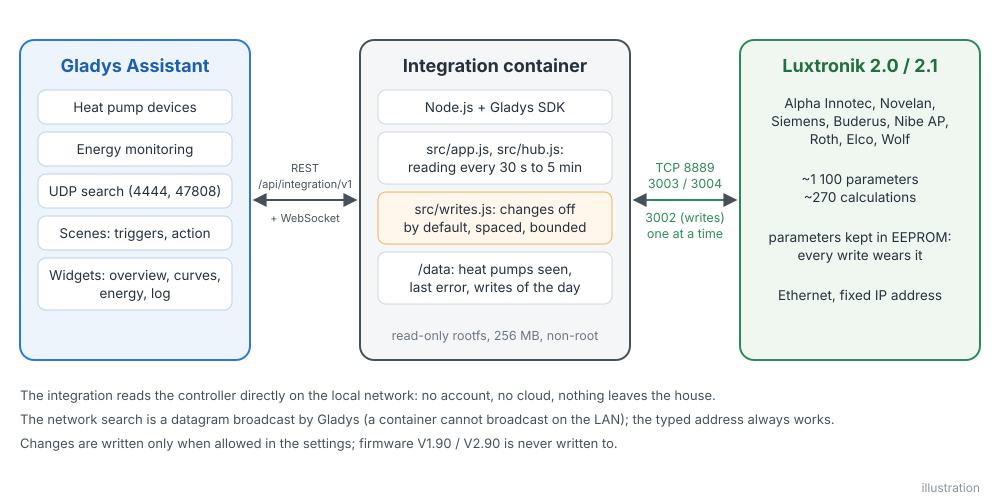
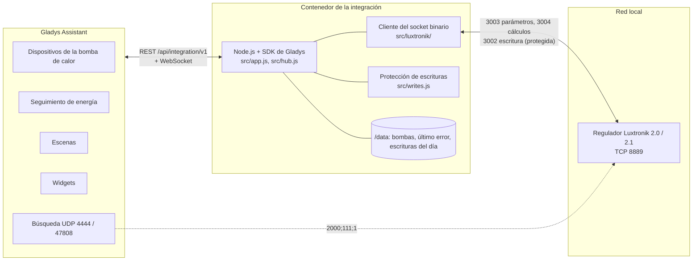
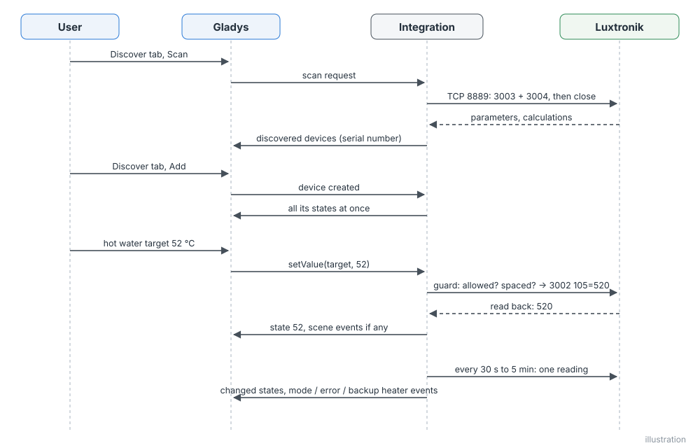
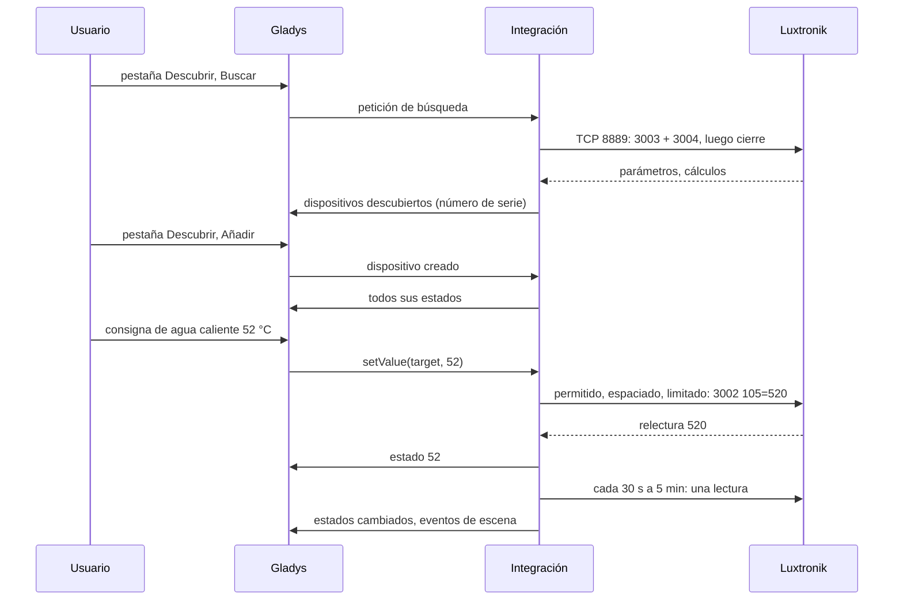
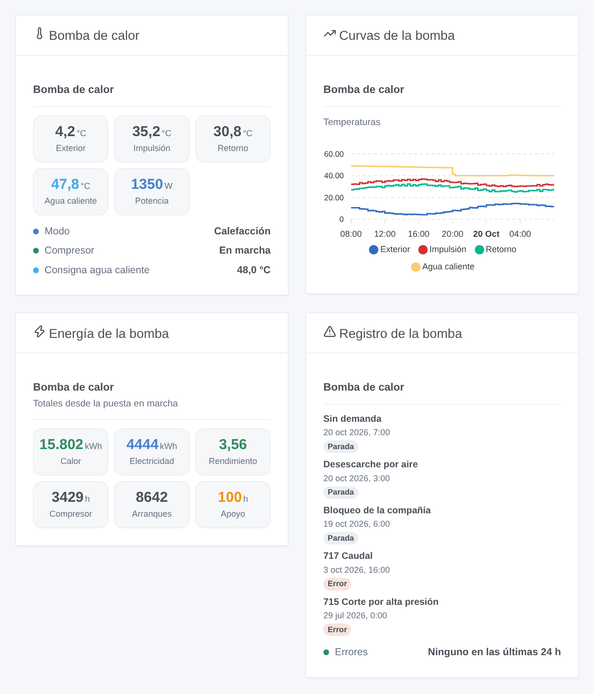
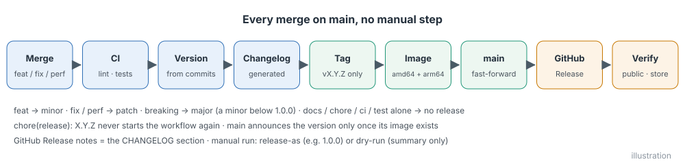

# Luxtronik para Gladys Assistant

[English](README.md) | [Français](README.fr.md) | [Deutsch](README.de.md) | **Español**

[](LICENSE)
[](https://github.com/William-De71/gladys-luxtronik/releases)
[](https://github.com/William-De71/gladys-luxtronik/actions/workflows/release.yml)
[](https://gladysassistant.com)


Su bomba de calor con un regulador Luxtronik 2.0 o 2.1 (Alpha Innotec, Novelan, Siemens, Buderus, Nibe AP, Roth, Elco, Wolf…) en Gladys Assistant, en su red local, sin ninguna nube. Temperaturas, modos, compresor, resistencia de apoyo, errores y energía se convierten en dispositivos de Gladys, con cuatro widgets, disparadores de escena y cambios cuidadosamente protegidos. No oficial, sin relación con Alpha Innotec.

## Funciones

- **Lectura en la red local** por el socket binario del regulador (puerto TCP 8889), el de las herramientas de Alpha Innotec y de las integraciones de Home Assistant: una sola conexión a la vez, cerrada después de cada lectura, cada 30 segundos a 5 minutos.
- **Hasta cuatro dispositivos por bomba de calor**: la propia bomba de calor (temperaturas, modo de funcionamiento, estado, último error, compresor, resistencia de apoyo, potencia y energía, contadores), calefacción (modo, temperatura +/-), agua caliente (temperatura, consigna, modo) y refrigeración (encendido / apagado, consigna), cada uno solo si la bomba de calor lo tiene.
- **Cambios desactivados por defecto**: una vez permitidos, los modos de calefacción y agua caliente, la temperatura +/-, la consigna de agua caliente y la refrigeración se cambian dentro de límites fijos, nunca dos veces el mismo valor, un ajuste como máximo cada 2 minutos, 50 cambios al día como máximo, nunca en el firmware que se bloquea al escribir.
- **Energía para Gladys**: electricidad consumida (un índice para el seguimiento de energía de Gladys), potencia eléctrica, potencia térmica y calor producido cuando el regulador los proporciona.
- **Cuatro widgets de panel**: lo que hace la bomba de calor, sus curvas de temperatura, su energía y su rendimiento, su registro de errores y paradas.
- **Seis disparadores de escena** (error, cambio de modo incluido el desescarche, resistencia de apoyo encendida / apagada, bomba perdida / recuperada) y **una acción de escena** (leer la bomba de calor).
- El número de serie identifica la bomba de calor: se sigue una nueva dirección IP. La búsqueda en red de Alpha Innotec se intenta a través de Gladys.
- Inglés, francés, alemán y español.

## Funcionamiento





**Protocolo.** El regulador responde en el puerto TCP 8889 con enteros de 32 bits big-endian: `3003` devuelve los unos 1 100 parámetros (ajustes, guardados en su EEPROM), `3004` los unos 270 cálculos (medidas y estados), `3002 <índice> <valor>` escribe un parámetro. **Luxtronik 2.0 y 2.1 (firmwares V1.x, V2.x y V3.x) mantienen ambos este puerto**: las integraciones de Home Assistant y python-luxtronik lo usan con todos los firmwares. El WebSocket de la interfaz web (puerto 8214, contraseña, XML) no aporta nada más y no se usa; tampoco la «interfaz de hogar inteligente» Modbus de los firmwares recientes (puerto 502, que hay que activar en el regulador).

**Descubrimiento.** Las direcciones escritas siempre se leen. La integración también pide a Gladys que difunda el datagrama de búsqueda de Alpha Innotec en UDP 4444 y 47808 (un contenedor no puede difundir en la red local): un regulador que responde también se lee. Las herramientas de referencia lo envían desde el puerto de destino, Gladys desde uno cualquiera: puede que no todos los firmwares respondan, de ahí la dirección escrita.

**Escrituras.** Véase [Cambiar ajustes](#configuración). Los firmwares V1.90.x y V2.90.x se bloquean con cualquier escritura en el puerto 8889 (informado a BenPru/luxtronik): quedan en solo lectura. Desde la versión menor 88.3, el regulador sigue la consigna de agua caliente del parámetro 105, antes la del parámetro 2: la integración escribe y lee el correcto.





### Dispositivos y funciones

| Dispositivo de Gladys                      | Cuándo                         | Funciones                                                                                                                                                                                                                                                                                                                                                                                                |
| ------------------------------------------ | ------------------------------ | -------------------------------------------------------------------------------------------------------------------------------------------------------------------------------------------------------------------------------------------------------------------------------------------------------------------------------------------------------------------------------------------------------- |
| `heatpump` — Bomba de calor                | siempre                        | temperaturas `outdoor`, `outdoor_average`, `flow`, `return`, `return_target`, `hot_gas`, `source_in`, `source_out`, `room` (unidad de ambiente); textos `operating_mode`, `status`, `last_error`; `compressor`, `backup_heater` (encendido / apagado); `power_input` (W), `energy_input` (índice kWh), `heat_output` (W), `heat_produced` (kWh); `compressor_hours`, `compressor_starts`, `backup_hours` |
| `heating` — Bomba de calor – calefacción   | siempre                        | `mode` (selección: automático, 2.º generador, fiesta, vacaciones, apagado), `offset` (temperatura +/-, de −5 a +5 °C)                                                                                                                                                                                                                                                                                    |
| `dhw` — Bomba de calor – agua caliente     | la bomba produce agua caliente | `temperature`, `target` (de 30 a 65 °C), `mode` (selección), `heating` (calentando ahora)                                                                                                                                                                                                                                                                                                                |
| `cooling` — Bomba de calor – refrigeración | la bomba puede refrigerar      | `enabled` (refrigeración automática encendida / apagada), `target` (de 18 a 30 °C)                                                                                                                                                                                                                                                                                                                       |

Las funciones de potencia y energía solo aparecen si el regulador las proporciona (firmware reciente, contador de calor). Identificadores externos: `ext:<selector>:<dispositivo>:<número de serie>` (parámetros 874 y 875), funciones `…:<clave>`.

## Transporte

`transports: ["local"]`: el catálogo muestra la insignia **local**. Nada sale de la red local: ni cuenta, ni nube. Cada dispositivo publica **local** mientras el regulador responde y **inaccesible** si no; no hay preferencia local que elegir ni modo degradado.

## Widgets



Cada widget tiene un ajuste **Bomba de calor** (la primera si está vacío).

- **Bomba de calor** (`overview`): temperaturas exterior, de impulsión, de retorno y de agua caliente, potencia absorbida (o térmica), modo de funcionamiento, estado, compresor, resistencia de apoyo cuando funciona, consigna de agua caliente.
- **Curvas de la bomba** (`history`, ajuste `period`: 24 horas, 3 o 7 días): temperaturas exterior, de impulsión, de retorno y de agua caliente según el historial de Gladys (los dispositivos deben estar añadidos).
- **Energía de la bomba** (`energy`): calor producido, electricidad consumida, rendimiento (calor ÷ electricidad desde la puesta en marcha, cuando existen ambos contadores), horas y arranques del compresor, horas de la resistencia.
- **Registro de la bomba** (`log`): los últimos errores (código y significado) y paradas del compresor (motivo) con sus fechas, y si hubo un error en las últimas 24 horas.

## Disparadores y acciones de escena

Disparadores (filtro `device`: una bomba de calor, cualquiera si está vacío):

- `error_occurred` — **La bomba de calor indica un error**: una nueva entrada en su registro de errores. Variables: `device_name`, `error_code`, `error_text` (en el idioma configurado).
- `mode_changed` — **La bomba de calor cambia de modo**. Filtros: `mode`, `previous_mode` (`heating`, `hot_water`, `pool`, `grid_lock`, `defrost`, `idle`, `external_heating`, `cooling`). Variables: `device_name`, `mode_text`.
- `backup_heater_started` — **La resistencia de apoyo se enciende**. Variables: `device_name`, `outdoor_temperature`.
- `backup_heater_stopped` — **La resistencia de apoyo se apaga**. Variables: `device_name`, `run_minutes`.
- `heat_pump_offline` — **La bomba de calor deja de responder** (3 minutos). Variables: `device_name`, `address`.
- `heat_pump_online` — **La bomba de calor vuelve a responder** (después de una pérdida).

Acción:

- `read_values` — **Leer la bomba de calor** (`device`): una lectura reciente. Salidas `operating_mode`, `status`, `outdoor_temperature`, `flow_temperature`, `return_temperature`, `hot_water_temperature`, `hot_water_target`, `power_input_w`, `heat_output_w`, `last_error_code` (0: ninguno), `last_error_text`.

Ejemplos:

- **La bomba de calor indica un error** → enviar una notificación «Bomba de calor: {{triggerEvent.data.error_text}}».
- **La resistencia de apoyo se enciende** → enviar un mensaje: la bomba de calor usa su resistencia, conviene revisarla.
- **La bomba de calor cambia de modo**, `mode` = `defrost` → no encender ahora el extractor del baño.

## Requisitos

- Gladys Assistant **5.3.0 o posterior** (palabras clave del catálogo de Gladys 5.3, widgets de panel y disparadores y acciones de escena de las integraciones; las instancias más antiguas no pueden instalar la integración).
- Un regulador Luxtronik 2.0 o 2.1 conectado a la red por cable, con una dirección IP fija (una reserva DHCP en su router).

## Instalación

- **Desde la tienda**: Integraciones → buscar «Luxtronik» → Instalar. Acepte el descubrimiento de red (UDP 4444 y 47808) en la pantalla de instalación.
- **Desde la URL del repositorio**: Integraciones → Instalar una integración → pegar `https://github.com/William-De71/gladys-luxtronik`.
- **Modo desarrollador**: Integraciones → Instalar una integración → Modo desarrollador, con el manifiesto de un build (el resumen del workflow «Build and publish image» lo muestra).

## Configuración

| Campo            | Tipo    | Por defecto | Significado                                                                                    |
| ---------------- | ------- | ----------- | ---------------------------------------------------------------------------------------------- |
| `hosts`          | string  | vacío       | direcciones IP de los reguladores, separadas por comas; `:puerto` solo si no es 8889           |
| `network_search` | boolean | `true`      | difundir también la búsqueda de Alpha Innotec (UDP 4444 y 47808) a través de Gladys            |
| `poll_interval`  | select  | `60`        | segundos entre dos lecturas: 30, 60, 120, 300                                                  |
| `allow_writes`   | boolean | `false`     | permitir cambios (modos, temperatura +/-, consigna de agua caliente, refrigeración)            |
| `language`       | select  | `en`        | idioma de los nombres de las funciones, de los modos, de los estados de texto y de los errores |

Protecciones de los cambios: un valor ya puesto nunca se escribe; un mismo ajuste como máximo cada 2 minutos; 50 cambios al día por bomba de calor (contados en `/data/writes.json`); límites: agua caliente 30–65 °C, temperatura +/- −5–+5 °C, refrigeración 18–30 °C, pasos de 0,5 °C; el valor se vuelve a leer; nunca se escribe en los firmwares V1.90.x / V2.90.x.

Botón de la página de configuración: **Buscar y probar las bombas de calor** (lee las direcciones y busca en la red, lista cada bomba de calor con su dirección, su firmware, su número de serie y si se puede modificar).

## Uso

1. Instale la integración, escriba la dirección IP del regulador y pulse **Buscar y probar las bombas de calor**.
2. Añada los dispositivos de la bomba de calor desde la pestaña **Descubrir**.
3. Ponga **Electricidad consumida** en el seguimiento de energía de Gladys, añada los widgets a un panel, cree sus escenas. Permita los cambios solo si los necesita.

La documentación de usuario está en [docs/es.md](docs/es.md) ([en](docs/en.md), [fr](docs/fr.md), [de](docs/de.md)).

## Límites

- **Nunca probado con una bomba de calor real**: todo se prueba contra un regulador simulado (un servidor TCP local real que habla el protocolo del puerto 8889), verificado a su vez con python-luxtronik, la biblioteca de las integraciones de Home Assistant. Se agradecen los comentarios.
- La búsqueda en red puede no encontrar nada con algunos firmwares: escriba la dirección.
- Solo se pueden cambiar los ajustes principales: ni puntos de la curva de calefacción, ni programas horarios, ni carga puntual de agua caliente, ni ajustes de piscina, ventilación o solar, ni Smart Grid. Los circuitos mezclados 2 y 3 no se gestionan.
- La «interfaz de hogar inteligente» Modbus (puerto 502) de los firmwares recientes, que escribe en RAM sin desgastar la EEPROM, aún no se usa.
- El significado de algunos registros varía según el firmware (contadores de energía, unidad de ambiente): un valor que parezca incorrecto merece una issue con su versión de firmware.

## Desarrollo local

```bash
npm install
node scripts/fake-controller.mjs 8889            # un regulador simulado, si no tiene bomba de calor
GLADYS_HOST_API_URL=http://localhost:1443 \
  GLADYS_INTEGRATION_TOKEN=… GLADYS_INTEGRATION_SELECTOR=… \
  LUXTRONIK_DATA_DIR=./data DEBUG=gladys-integration-sdk node index.js
```

| Variable                                                                         | Por defecto        | Uso                                            |
| -------------------------------------------------------------------------------- | ------------------ | ---------------------------------------------- |
| `GLADYS_HOST_API_URL`, `GLADYS_INTEGRATION_TOKEN`, `GLADYS_INTEGRATION_SELECTOR` | puestas por Gladys | conexión a la API anfitriona de Gladys         |
| `LUXTRONIK_DATA_DIR`                                                             | `/data`            | carpeta de `pumps.json` y `writes.json`        |
| `DEBUG`                                                                          | sin definir        | `gladys-integration-sdk` para los logs del SDK |

| Script                            | Qué hace                                                          |
| --------------------------------- | ----------------------------------------------------------------- |
| `npm test`                        | las pruebas (`node --test`), nada sale de 127.0.0.1               |
| `npm run lint`                    | ESLint                                                            |
| `npm run format` / `format:check` | Prettier                                                          |
| `scripts/fake-controller.mjs`     | lanzar el regulador simulado de las pruebas                       |
| `scripts/check-simulator.sh`      | verificar el regulador simulado con python-luxtronik (virtualenv) |
| `docs/illustrations/render.sh`    | regenerar las ilustraciones de los widgets                        |
| `scripts/build-cover.sh`          | regenerar `cover.jpg` a partir de `cover.svg`                     |

## Pruebas

`npm test` ejecuta toda la integración contra el Gladys simulado del SDK y un regulador Luxtronik simulado en un socket local real (respuestas cortadas en pequeños trozos TCP, conexiones mudas o rechazadas, número de conexiones abiertas a la vez y cada escritura registrados). Cubiertos: el protocolo (3002 a 3005), la decodificación (escalas, valores «no disponibles», sondas sin cablear, reglas de firmware), el descubrimiento por dirección y por la búsqueda a través de Gladys, cada dispositivo y cada valor, las escrituras y cada protección (casilla, límites, mismo valor, espaciado, cupo diario conservado tras reinicios, firmware V2.90, registro de agua caliente de los firmwares antiguos), los disparadores y la acción de escena, los cuatro widgets validados por `validateWidgetContent`, las bombas perdidas y recuperadas, los reinicios. Los dispositivos se comprueban contra las reglas del núcleo de Gladys y una referencia de descubrimiento (los identificadores externos son para siempre), el manifiesto contra el código, las traducciones y el script de release. La CI también construye la imagen y la arranca como Gladys (solo lectura, 256 MB, sin red).

## Proceso de release

Cada fusión en `main` publica una release cuando sus commits lo justifican, sin ningún paso manual:

```mermaid
flowchart LR
  A[fusión en main] --> B[CI: Prettier, ESLint,<br/>pruebas, build Docker]
  B --> C[versión siguiente según<br/>los Conventional Commits]
  C --> D[sección de CHANGELOG.md]
  D --> E[commit chore release<br/>+ tag vX.Y.Z]
  E --> F[imagen :X.Y.Z + :latest<br/>amd64 + arm64]
  F --> G[main avanza al<br/>commit de release]
  G --> H[GitHub Release]
  H --> I[verificación: pull anónimo,<br/>validador de la tienda, topic]
```





- `feat` → menor, `fix` / `perf` → parche, `!` o `BREAKING CHANGE:` → mayor (una menor mientras < 1.0.0). `docs`, `chore`, `ci`, `test`, `style`, `refactor`, `build` solos no publican nada.
- El título de la pull request se convierte en el commit squash, es decir, en la línea del changelog: escríbalo en inglés, para el usuario (`feat(widgets): …`). `pr-title.yml` lo comprueba. Nunca edite `CHANGELOG.md` a mano.
- La imagen existe antes de que `main` anuncie su versión (la tienda indexa `main`).
- La 1.0.0 es una decisión manual: Actions → Release → Run workflow, `release-as: 1.0.0`. `dry-run` muestra la versión y el changelog sin publicar nada.
- **`main` protegida**: la release empuja un commit a `main`. Con una protección de rama o un ruleset que exija pull requests o status checks, permita que GitHub Actions los omita (o use una GitHub App); si no, la release se detiene tras la imagen.
- Tras la primera release, haga público el paquete si hace falta: Package settings → Change visibility → Public.

## Solución de problemas

- **«Ninguna bomba de calor responde en el puerto 8889»**: compruebe la dirección IP en el regulador (Servicio > Información), el cable de red y que ninguna otra herramienta mantenga una conexión abierta (el regulador acepta pocos clientes).
- **La búsqueda en red no encuentra nada**: escriba la dirección; compruebe también que nada más en el equipo de Gladys use UDP 4444 o 47808 (47808 es el puerto BACnet).
- **«Los cambios están desactivados»**: marque **Permitir cambios**. **«vuelva a intentarlo en … s»**: el mismo ajuste se cambió hace menos de 2 minutos.
- **«El firmware … bloquea el regulador con cada cambio»**: firmware V1.90 / V2.90; pida a su instalador que lo actualice, la lectura funciona.
- **«Gladys rechazó la búsqueda en la red»**: reinstale la integración y acepte su descubrimiento de red en la pantalla de instalación.
- Logs: la pestaña Logs de la integración; `DEBUG=gladys-integration-sdk` para el detalle del SDK.

## Contribuir

Issues y pull requests son bienvenidas. Ejecute `npm run format:check`, `npm run lint` y `npm test`, escriba el título de la pull request como Conventional Commit y vuelva a ejecutar `docs/illustrations/render.sh` tras cualquier cambio de un contenido de widget. Una nueva función no debe cambiar las existentes (`test/fixtures/discovery.baseline.json`). Cuando un regulador real se comporte de otro modo, corrija primero el regulador simulado de `test/helpers/` (y verifíquelo con `scripts/check-simulator.sh`), luego el código.

## Seguridad

Véase [SECURITY.md](SECURITY.md). No hay ningún secreto: el regulador no tiene autenticación en el puerto 8889, por eso debe quedarse en una red de confianza, nunca expuesto a Internet. `/data` guarda la dirección, el puerto y el número de serie de cada bomba de calor vista, la fecha del último error visto y las escrituras del día. Los cambios están desactivados por defecto.

## Licencia

[Licencia Apache 2.0](LICENSE), véase también [NOTICE](NOTICE). El cliente se escribió para este proyecto a partir de la comprensión del protocolo documentado por python-luxtronik y BenPru/luxtronik (MIT); no se copió ningún código. Luxtronik y Alpha Innotec son marcas de sus propietarios; este proyecto no está afiliado, respaldado ni apoyado por ellos.
