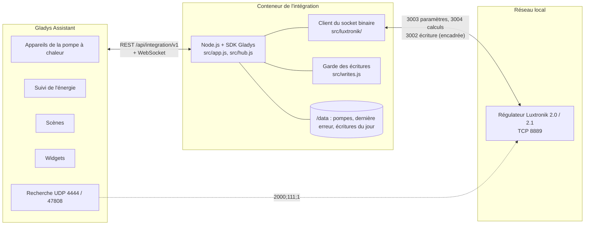
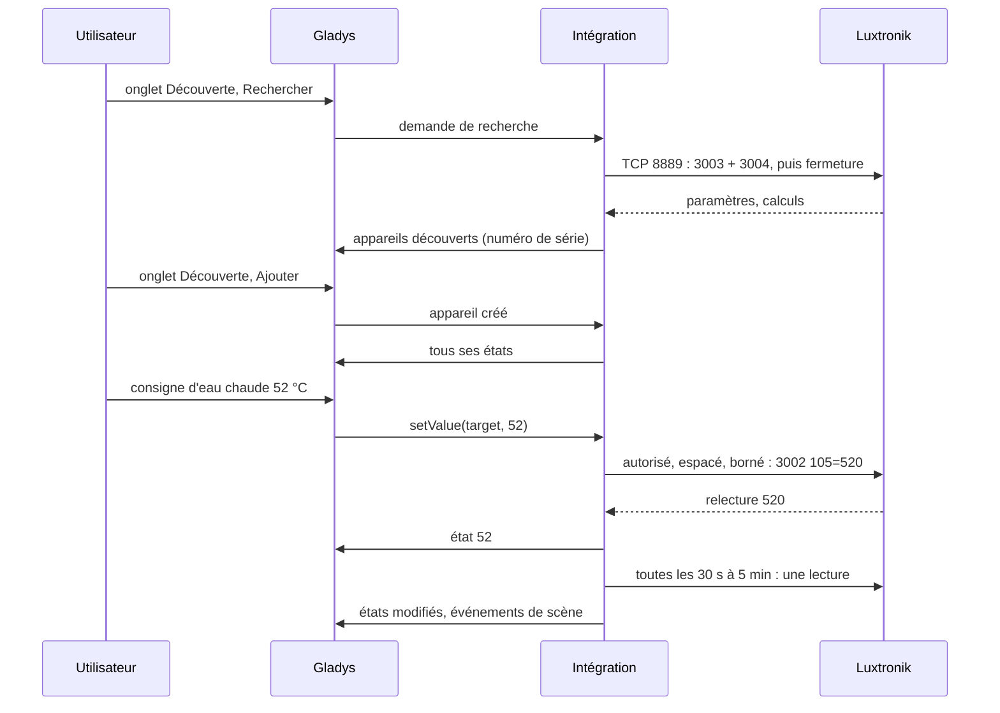
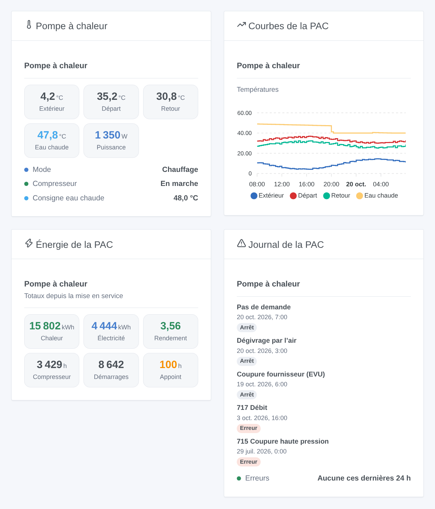

# Luxtronik pour Gladys Assistant

[English](README.md) | **Français** | [Deutsch](README.de.md) | [Español](README.es.md)

[](LICENSE)
[](https://github.com/William-De71/gladys-luxtronik/releases)
[](https://github.com/William-De71/gladys-luxtronik/actions/workflows/release.yml)
[](https://gladysassistant.com)


Votre pompe à chaleur équipée d’un régulateur Luxtronik 2.0 ou 2.1 (Alpha Innotec, Novelan, Siemens, Buderus, Nibe AP, Roth, Elco, Wolf…) dans Gladys Assistant, sur votre réseau local, sans aucun cloud. Températures, modes, compresseur, appoint, erreurs et énergie deviennent des appareils Gladys, avec quatre widgets, des déclencheurs de scène et des modifications soigneusement encadrées. Non officiel, sans lien avec Alpha Innotec.

## Fonctionnalités

- **Lecture sur le réseau local** par le socket binaire du régulateur (port TCP 8889), celui des outils Alpha Innotec et des intégrations Home Assistant : une connexion à la fois, fermée après chaque lecture, toutes les 30 secondes à 5 minutes.
- **Jusqu’à quatre appareils par pompe à chaleur** : la pompe à chaleur elle-même (températures, mode de fonctionnement, état, dernière erreur, compresseur, appoint, puissance et énergie, compteurs), le chauffage (mode, température +/-), l’eau chaude (température, consigne, mode) et le rafraîchissement (marche / arrêt, consigne), chacun seulement si la pompe à chaleur l’a.
- **Modifications désactivées par défaut** : une fois autorisées, les modes chauffage et eau chaude, la température +/-, la consigne d’eau chaude et le rafraîchissement se modifient dans des bornes fixes, jamais deux fois la même valeur, un réglage au plus toutes les 2 minutes, 50 modifications par jour au maximum, jamais sur le firmware qui plante à l’écriture.
- **Énergie pour Gladys** : électricité consommée (un index pour le suivi de l’énergie de Gladys), puissance électrique, puissance thermique et chaleur produite quand le régulateur les fournit.
- **Quatre widgets de tableau de bord** : ce que fait la pompe à chaleur, ses courbes de température, son énergie et son rendement, son journal d’erreurs et d’arrêts.
- **Six déclencheurs de scène** (erreur, changement de mode dont le dégivrage, appoint en marche / à l’arrêt, pompe perdue / retrouvée) et **une action de scène** (lire la pompe à chaleur).
- Le numéro de série identifie la pompe à chaleur : une nouvelle adresse IP est suivie. La recherche réseau Alpha Innotec est tentée via Gladys.
- Anglais, français, allemand et espagnol.

## Fonctionnement




**Protocole.** Le régulateur répond sur le port TCP 8889 en entiers 32 bits gros-boutistes : `3003` renvoie les quelque 1 100 paramètres (réglages, conservés dans son EEPROM), `3004` les quelque 270 calculs (mesures et états), `3002 <index> <valeur>` écrit un paramètre. **Luxtronik 2.0 et 2.1 (firmwares V1.x, V2.x et V3.x) gardent tous deux ce port** : les intégrations Home Assistant et python-luxtronik l’utilisent sur tous les firmwares. Le WebSocket de l’interface web (port 8214, mot de passe, XML) n’apporte rien de plus et n’est pas utilisé ; pas plus que l’« interface maison connectée » Modbus des firmwares récents (port 502, à activer sur le régulateur).

**Découverte.** Les adresses saisies sont toujours lues. L’intégration demande aussi à Gladys de diffuser le datagramme de recherche Alpha Innotec sur UDP 4444 et 47808 (un conteneur ne peut pas diffuser sur le réseau local) : un régulateur qui répond est lu lui aussi. Les outils de référence l’envoient depuis le port de destination, Gladys depuis un port quelconque : tous les firmwares ne répondent peut-être pas, d’où l’adresse saisie.

**Écritures.** Voir [Modifier les réglages](#configuration). Les firmwares V1.90.x et V2.90.x plantent à toute écriture sur le port 8889 (signalé à BenPru/luxtronik) : ils restent en lecture seule. Depuis la version mineure 88.3, le régulateur suit la consigne d’eau chaude du paramètre 105, avant celle du paramètre 2 : l’intégration écrit et lit le bon.




### Appareils et fonctionnalités

| Appareil Gladys                                | Quand                         | Fonctionnalités                                                                                                                                                                                                                                                                                                                                                                                         |
| ---------------------------------------------- | ----------------------------- | ------------------------------------------------------------------------------------------------------------------------------------------------------------------------------------------------------------------------------------------------------------------------------------------------------------------------------------------------------------------------------------------------------- |
| `heatpump` — Pompe à chaleur                   | toujours                      | températures `outdoor`, `outdoor_average`, `flow`, `return`, `return_target`, `hot_gas`, `source_in`, `source_out`, `room` (commande d’ambiance) ; textes `operating_mode`, `status`, `last_error` ; `compressor`, `backup_heater` (marche / arrêt) ; `power_input` (W), `energy_input` (index kWh), `heat_output` (W), `heat_produced` (kWh) ; `compressor_hours`, `compressor_starts`, `backup_hours` |
| `heating` — Pompe à chaleur – chauffage        | toujours                      | `mode` (sélection : automatique, 2e générateur, party, vacances, arrêt), `offset` (température +/-, −5 à +5 °C)                                                                                                                                                                                                                                                                                         |
| `dhw` — Pompe à chaleur – eau chaude           | la pompe produit l’eau chaude | `temperature`, `target` (30 à 65 °C), `mode` (sélection), `heating` (production en cours)                                                                                                                                                                                                                                                                                                               |
| `cooling` — Pompe à chaleur – rafraîchissement | la pompe peut rafraîchir      | `enabled` (rafraîchissement automatique marche / arrêt), `target` (18 à 30 °C)                                                                                                                                                                                                                                                                                                                          |

Les fonctionnalités de puissance et d’énergie n’apparaissent que si le régulateur les fournit (firmware récent, compteur de chaleur). Identifiants externes : `ext:<selector>:<appareil>:<numéro de série>` (paramètres 874 et 875), fonctionnalités `…:<clé>`.

## Transport

`transports: ["local"]` : le catalogue affiche le badge **local**. Rien ne sort du réseau local : ni compte, ni cloud. Chaque appareil publie **local** tant que le régulateur répond et **injoignable** sinon ; il n’y a ni préférence locale à choisir, ni mode dégradé.

## Widgets



Chaque widget a un réglage **Pompe à chaleur** (la première si vide).

- **Pompe à chaleur** (`overview`) : températures extérieure, de départ, de retour et d’eau chaude, puissance absorbée (ou thermique), mode de fonctionnement, état, compresseur, appoint quand il tourne, consigne d’eau chaude.
- **Courbes de la PAC** (`history`, réglage `period` : 24 heures, 3 ou 7 jours) : températures extérieure, de départ, de retour et d’eau chaude d’après l’historique de Gladys (les appareils doivent être ajoutés).
- **Énergie de la PAC** (`energy`) : chaleur produite, électricité consommée, rendement (chaleur ÷ électricité depuis la mise en service, quand les deux compteurs existent), heures et démarrages du compresseur, heures de l’appoint.
- **Journal de la PAC** (`log`) : les dernières erreurs (code et signification) et arrêts du compresseur (motif) avec leurs dates, et si une erreur est survenue ces dernières 24 heures.

## Déclencheurs et actions de scène

Déclencheurs (filtre `device` : une pompe à chaleur, toutes si vide) :

- `error_occurred` — **La pompe à chaleur signale une erreur** : une nouvelle entrée dans son journal d’erreurs. Variables : `device_name`, `error_code`, `error_text` (dans la langue configurée).
- `mode_changed` — **La pompe à chaleur change de mode**. Filtres : `mode`, `previous_mode` (`heating`, `hot_water`, `pool`, `grid_lock`, `defrost`, `idle`, `external_heating`, `cooling`). Variables : `device_name`, `mode_text`.
- `backup_heater_started` — **L’appoint électrique démarre**. Variables : `device_name`, `outdoor_temperature`.
- `backup_heater_stopped` — **L’appoint électrique s’arrête**. Variables : `device_name`, `run_minutes`.
- `heat_pump_offline` — **La pompe à chaleur ne répond plus** (3 minutes). Variables : `device_name`, `address`.
- `heat_pump_online` — **La pompe à chaleur répond de nouveau** (après une perte).

Action :

- `read_values` — **Lire la pompe à chaleur** (`device`) : une lecture fraîche. Sorties `operating_mode`, `status`, `outdoor_temperature`, `flow_temperature`, `return_temperature`, `hot_water_temperature`, `hot_water_target`, `power_input_w`, `heat_output_w`, `last_error_code` (0 : aucune), `last_error_text`.

Exemples :

- **La pompe à chaleur signale une erreur** → envoyer une notification « PAC : {{triggerEvent.data.error_text}} ».
- **L’appoint électrique démarre** → envoyer un message : la pompe à chaleur utilise sa résistance, à vérifier.
- **La pompe à chaleur change de mode**, `mode` = `defrost` → ne pas lancer la VMC de la salle de bain maintenant.

## Prérequis

- Gladys Assistant **5.3.0 ou plus récent** (mots-clés du catalogue de Gladys 5.3, widgets de tableau de bord et déclencheurs et actions de scène des intégrations ; les instances plus anciennes ne peuvent pas installer l’intégration).
- Un régulateur Luxtronik 2.0 ou 2.1 branché au réseau par un câble, avec une adresse IP fixe (une réservation DHCP dans votre box).

## Installation

- **Depuis le store** : Intégrations → rechercher « Luxtronik » → Installer. Acceptez la découverte réseau (UDP 4444 et 47808) sur l’écran d’installation.
- **Depuis l’URL du dépôt** : Intégrations → Installer une intégration → coller `https://github.com/William-De71/gladys-luxtronik`.
- **Mode développeur** : Intégrations → Installer une intégration → Mode développeur, avec le manifeste d’un build (le résumé du workflow « Build and publish image » l’affiche).

## Configuration

| Champ            | Type    | Défaut  | Signification                                                                                   |
| ---------------- | ------- | ------- | ----------------------------------------------------------------------------------------------- |
| `hosts`          | string  | vide    | adresses IP des régulateurs, séparées par des virgules ; `:port` seulement si ce n’est pas 8889 |
| `network_search` | boolean | `true`  | diffuser aussi la recherche Alpha Innotec (UDP 4444 et 47808) via Gladys                        |
| `poll_interval`  | select  | `60`    | secondes entre deux lectures : 30, 60, 120, 300                                                 |
| `allow_writes`   | boolean | `false` | autoriser les modifications (modes, température +/-, consigne d’eau chaude, rafraîchissement)   |
| `language`       | select  | `en`    | langue des noms des fonctionnalités, des modes, des états texte et des erreurs de scène         |

Garde-fous des modifications : une valeur déjà en place n’est jamais écrite ; un même réglage au plus toutes les 2 minutes ; 50 modifications par jour et par pompe à chaleur (comptées dans `/data/writes.json`) ; bornes : eau chaude 30–65 °C, température +/- −5–+5 °C, rafraîchissement 18–30 °C, pas de 0,5 °C ; la valeur est relue ; jamais d’écriture sur les firmwares V1.90.x / V2.90.x.

Bouton de la page de configuration : **Rechercher et tester les pompes à chaleur** (lit les adresses et cherche sur le réseau, liste chaque pompe à chaleur avec son adresse, son firmware, son numéro de série et la possibilité de la modifier).

## Utilisation

1. Installez l’intégration, saisissez l’adresse IP du régulateur, puis appuyez sur **Rechercher et tester les pompes à chaleur**.
2. Ajoutez les appareils de la pompe à chaleur depuis l’onglet **Découverte**.
3. Mettez **Électricité consommée** dans le suivi de l’énergie de Gladys, ajoutez les widgets à un tableau de bord, créez vos scènes. N’autorisez les modifications que si vous en avez besoin.

La documentation utilisateur est dans [docs/fr.md](docs/fr.md) ([en](docs/en.md), [de](docs/de.md), [es](docs/es.md)).

## Limites

- **Jamais testé sur une vraie pompe à chaleur** : tout est testé contre un régulateur simulé (un vrai serveur TCP local qui parle le protocole du port 8889), lui-même vérifié avec python-luxtronik, la bibliothèque des intégrations Home Assistant. Vos retours sont les bienvenus.
- La recherche réseau peut ne rien trouver avec certains firmwares : saisissez l’adresse.
- Seuls les réglages principaux se modifient : pas de points de la courbe de chauffe, pas de programmes horaires, pas de charge d’eau chaude ponctuelle, pas de réglages piscine, ventilation ou solaire, pas de Smart Grid. Les circuits mélangés 2 et 3 ne sont pas gérés.
- L’« interface maison connectée » Modbus (port 502) des firmwares récents, qui écrit en RAM sans user l’EEPROM, n’est pas encore utilisée.
- Le sens de certains registres varie selon le firmware (compteurs d’énergie, commande d’ambiance) : une valeur qui semble fausse mérite une issue avec votre version de firmware.

## Développement local

```bash
npm install
node scripts/fake-controller.mjs 8889            # un faux régulateur, si vous n'avez pas de pompe à chaleur
GLADYS_HOST_API_URL=http://localhost:1443 \
  GLADYS_INTEGRATION_TOKEN=… GLADYS_INTEGRATION_SELECTOR=… \
  LUXTRONIK_DATA_DIR=./data DEBUG=gladys-integration-sdk node index.js
```

| Variable                                                                         | Défaut              | Usage                                         |
| -------------------------------------------------------------------------------- | ------------------- | --------------------------------------------- |
| `GLADYS_HOST_API_URL`, `GLADYS_INTEGRATION_TOKEN`, `GLADYS_INTEGRATION_SELECTOR` | fournies par Gladys | connexion à l’API hôte de Gladys              |
| `LUXTRONIK_DATA_DIR`                                                             | `/data`             | dossier de `pumps.json` et `writes.json`      |
| `DEBUG`                                                                          | absente             | `gladys-integration-sdk` pour les logs du SDK |

| Script                            | Rôle                                                           |
| --------------------------------- | -------------------------------------------------------------- |
| `npm test`                        | les tests (`node --test`), rien ne sort de 127.0.0.1           |
| `npm run lint`                    | ESLint                                                         |
| `npm run format` / `format:check` | Prettier                                                       |
| `scripts/fake-controller.mjs`     | lancer le faux régulateur des tests                            |
| `scripts/check-simulator.sh`      | vérifier le faux régulateur avec python-luxtronik (virtualenv) |
| `docs/illustrations/render.sh`    | régénérer les illustrations des widgets                        |
| `scripts/build-cover.sh`          | régénérer `cover.jpg` depuis `cover.svg`                       |

## Tests

`npm test` fait tourner toute l’intégration contre le faux Gladys du SDK et un faux régulateur Luxtronik sur un vrai socket local (réponses découpées en petits morceaux TCP, connexions muettes ou refusées, nombre de connexions ouvertes en même temps et chaque écriture enregistrés). Couverts : le protocole (3002 à 3005), le décodage (échelles, valeurs « non disponibles », sondes non câblées, règles de firmware), la découverte par adresse et par la recherche via Gladys, chaque appareil et chaque valeur, les écritures et chaque garde-fou (case à cocher, bornes, même valeur, espacement, quota journalier conservé au redémarrage, firmware V2.90, registre d’eau chaude des anciens firmwares), les déclencheurs et l’action de scène, les quatre widgets validés par `validateWidgetContent`, les pompes perdues et retrouvées, les redémarrages. Les appareils sont vérifiés contre les règles du cœur de Gladys et une référence de découverte (les identifiants externes sont éternels), le manifeste contre le code, les traductions et le script de release. La CI construit aussi l’image et la lance comme Gladys (lecture seule, 256 Mo, sans réseau).

## Processus de release

Chaque fusion sur `main` publie une release quand ses commits le justifient, sans aucune action manuelle :

```mermaid
flowchart LR
  A[fusion sur main] --> B[CI : Prettier, ESLint,<br/>tests, build Docker]
  B --> C[version suivante d'après<br/>les Conventional Commits]
  C --> D[section du CHANGELOG.md]
  D --> E[commit chore release<br/>+ tag vX.Y.Z]
  E --> F[image :X.Y.Z + :latest<br/>amd64 + arm64]
  F --> G[main avance au<br/>commit de release]
  G --> H[GitHub Release]
  H --> I[vérification : pull anonyme,<br/>validateur du store, topic]
```




- `feat` → mineure, `fix` / `perf` → correctif, `!` ou `BREAKING CHANGE:` → majeure (une mineure tant que < 1.0.0). `docs`, `chore`, `ci`, `test`, `style`, `refactor`, `build` seuls ne publient rien.
- Le titre de la pull request devient le commit squash, donc la ligne du changelog : écrivez-le en anglais, pour l’utilisateur (`feat(widgets): …`). `pr-title.yml` le vérifie. Ne modifiez jamais `CHANGELOG.md` à la main.
- L’image existe avant que `main` n’annonce sa version (le store indexe `main`).
- La 1.0.0 est une décision manuelle : Actions → Release → Run workflow, `release-as: 1.0.0`. `dry-run` affiche la version et le changelog sans rien publier.
- **`main` protégée** : la release pousse un commit sur `main`. Avec une protection de branche ou un ruleset qui exige des pull requests ou des status checks, autorisez GitHub Actions à les contourner (ou utilisez une GitHub App), sinon la release s’arrête après l’image.
- Après la première release, rendez le package public si besoin : Package settings → Change visibility → Public.

## Dépannage

- **« Aucune pompe à chaleur ne répond sur le port 8889 »** : vérifiez l’adresse IP sur le régulateur (Service > Information), le câble réseau, et qu’aucun autre outil ne garde une connexion ouverte (le régulateur accepte peu de clients).
- **La recherche réseau ne trouve rien** : saisissez l’adresse ; vérifiez aussi que rien d’autre sur la machine de Gladys n’utilise UDP 4444 ou 47808 (47808 est le port BACnet).
- **« Les modifications sont désactivées »** : cochez **Autoriser les modifications**. **« réessayez dans … s »** : le même réglage a été modifié il y a moins de 2 minutes.
- **« Le firmware … plante le régulateur à chaque modification »** : firmware V1.90 / V2.90 ; faites-le mettre à jour par votre installateur, la lecture fonctionne.
- **« Gladys a refusé la recherche réseau »** : réinstallez l’intégration et acceptez sa découverte réseau sur l’écran d’installation.
- Logs : l’onglet Logs de l’intégration ; `DEBUG=gladys-integration-sdk` pour le détail du SDK.

## Contribuer

Issues et pull requests bienvenues. Lancez `npm run format:check`, `npm run lint` et `npm test`, écrivez le titre de la pull request en Conventional Commit, et relancez `docs/illustrations/render.sh` après tout changement d’un contenu de widget. Une nouvelle fonctionnalité ne doit pas modifier les existantes (`test/fixtures/discovery.baseline.json`). Quand un vrai régulateur se comporte autrement, corrigez d’abord le faux régulateur de `test/helpers/` (et vérifiez-le avec `scripts/check-simulator.sh`), puis le code.

## Sécurité

Voir [SECURITY.md](SECURITY.md). Il n’y a aucun secret : le régulateur n’a aucune authentification sur le port 8889, c’est pourquoi il doit rester sur un réseau de confiance, jamais exposé à Internet. `/data` garde l’adresse, le port et le numéro de série de chaque pompe à chaleur vue, la date de la dernière erreur vue et les écritures du jour. Les modifications sont désactivées par défaut.

## Licence

[Licence Apache 2.0](LICENSE), voir aussi [NOTICE](NOTICE). Le client a été écrit pour ce projet d’après la compréhension du protocole documenté par python-luxtronik et BenPru/luxtronik (MIT) ; aucun code n’a été copié. Luxtronik et Alpha Innotec sont des marques de leurs propriétaires ; ce projet n’est ni affilié, ni approuvé, ni soutenu par eux.
