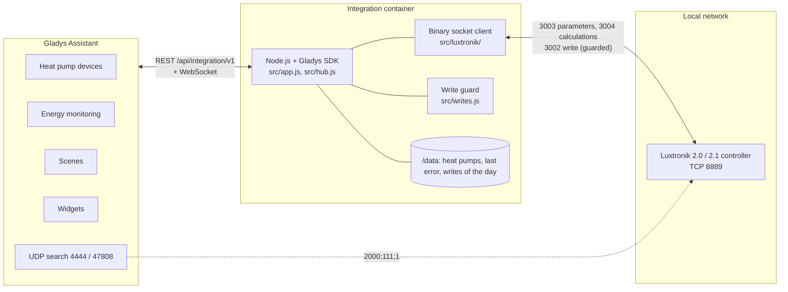
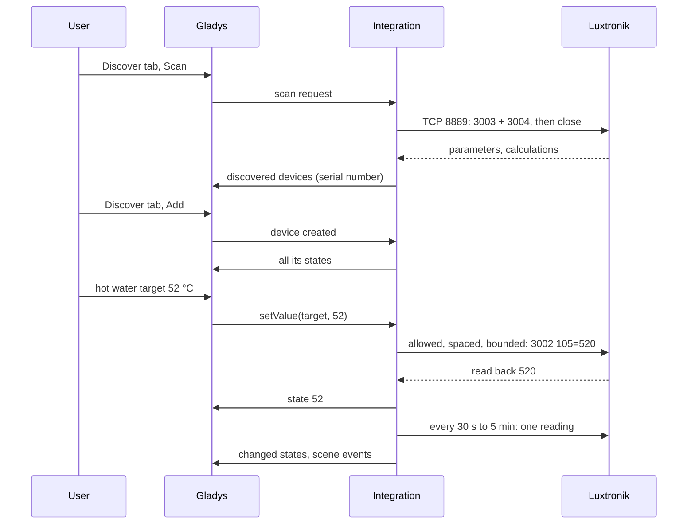
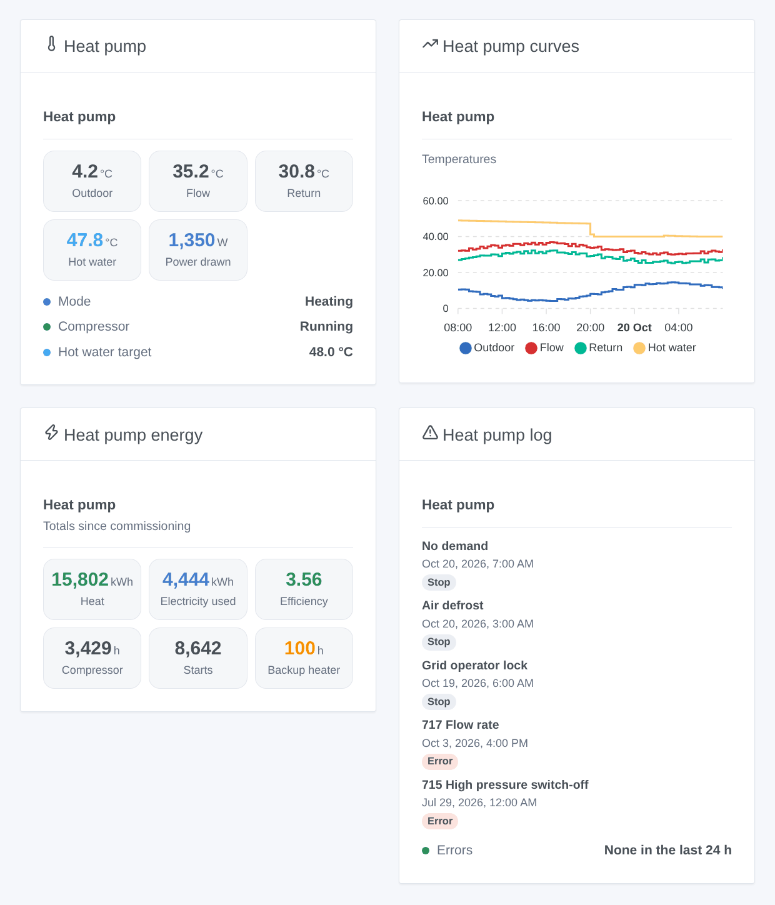

# Luxtronik for Gladys Assistant

**English** | [Français](README.fr.md) | [Deutsch](README.de.md) | [Español](README.es.md)

[](LICENSE)
[](https://github.com/William-De71/gladys-luxtronik/releases)
[](https://github.com/William-De71/gladys-luxtronik/actions/workflows/release.yml)
[](https://gladysassistant.com)


Your heat pump with a Luxtronik 2.0 or 2.1 controller (Alpha Innotec, Novelan, Siemens, Buderus, Nibe AP, Roth, Elco, Wolf…) in Gladys Assistant, on your local network, without any cloud. Temperatures, modes, compressor, backup heater, errors and energy become Gladys devices, with four widgets, scene triggers and carefully guarded changes. Unofficial, not affiliated with Alpha Innotec.

## Features

- **Read over the local network** through the binary socket of the controller (TCP port 8889), the one of the Alpha Innotec tools and of the Home Assistant integrations: one connection at a time, closed after each reading, every 30 seconds to 5 minutes.
- **Up to four devices per heat pump**: the heat pump itself (temperatures, operating mode, status, last error, compressor, backup heater, power and energy, counters), heating (mode, temperature +/-), hot water (temperature, target, mode) and cooling (on / off, target), each only when the heat pump has it.
- **Changes off by default**: once allowed, the heating and hot water modes, the temperature +/-, the hot water target and cooling can be changed, within fixed bounds, never twice the same value, one setting at most every 2 minutes, 50 changes a day at most, never on the firmware that crashes on writes.
- **Energy for Gladys**: electricity used (an index for the energy monitoring of Gladys), electrical power, heat output and heat produced when the controller reports them.
- **Four dashboard widgets**: what the heat pump does now, its temperature curves, its energy and efficiency, its error and switch-off log.
- **Six scene triggers** (error, operating mode change including defrost, backup heater on / off, heat pump lost / back) and **one scene action** (read the heat pump).
- The serial number identifies the heat pump: a new IP address is followed. The Alpha Innotec network search is tried through Gladys.
- English, French, German and Spanish.

## How it works




**Protocol.** The controller answers on TCP port 8889 with big-endian 32-bit integers: `3003` returns the ~1 100 parameters (settings, kept in its EEPROM), `3004` the ~270 calculations (measurements and states), `3002 <index> <value>` writes one parameter. **Luxtronik 2.0 and 2.1 (firmware V1.x, V2.x and V3.x) both keep this port**: the Home Assistant integrations and python-luxtronik use it on every firmware. The WebSocket of the web interface (port 8214, password, XML) gives nothing more and is not used; neither is the Modbus "smart home interface" of recent firmware (port 502, to be activated on the controller).

**Discovery.** The addresses you type are always read. The integration also asks Gladys to broadcast the Alpha Innotec search datagram on UDP 4444 and 47808 (a container cannot broadcast on the LAN): a controller that answers is read as well. The reference tools send it from the port they broadcast to, Gladys from a random one: not every firmware may answer it, hence the typed address.

**Writes.** See [Changing settings](#configuration). Firmware V1.90.x and V2.90.x crash on any write over port 8889 (reported to BenPru/luxtronik): they stay read only. Since minor version 88.3 the controller follows the hot water target in parameter 105, before in parameter 2: the integration writes and reads the right one.




### Devices and features

| Gladys device                   | When                     | Features                                                                                                                                                                                                                                                                                                                                                                           |
| ------------------------------- | ------------------------ | ---------------------------------------------------------------------------------------------------------------------------------------------------------------------------------------------------------------------------------------------------------------------------------------------------------------------------------------------------------------------------------- |
| `heatpump` — Heat pump          | always                   | temperatures `outdoor`, `outdoor_average`, `flow`, `return`, `return_target`, `hot_gas`, `source_in`, `source_out`, `room` (room unit); texts `operating_mode`, `status`, `last_error`; `compressor`, `backup_heater` (on / off); `power_input` (W), `energy_input` (kWh index), `heat_output` (W), `heat_produced` (kWh); `compressor_hours`, `compressor_starts`, `backup_hours` |
| `heating` — Heat pump – heating | always                   | `mode` (select: automatic, second heat source, party, holidays, off), `offset` (temperature +/-, −5 to +5 °C)                                                                                                                                                                                                                                                                      |
| `dhw` — Heat pump – hot water   | the pump makes hot water | `temperature`, `target` (30 to 65 °C), `mode` (select), `heating` (heating hot water now)                                                                                                                                                                                                                                                                                          |
| `cooling` — Heat pump – cooling | the pump can cool        | `enabled` (cooling automatic on / off), `target` (18 to 30 °C)                                                                                                                                                                                                                                                                                                                     |

Power and energy features appear only when the controller reports them (recent firmware, heat meter). External ids: `ext:<selector>:<device>:<serial>` (serial = parameters 874 and 875), features `…:<key>`.

## Transport

`transports: ["local"]`: the catalogue shows the **local** badge. Nothing leaves the local network: no account, no cloud. Each device publishes **local** while the controller answers and **unreachable** otherwise; there is no local preference to choose, nor degraded mode.

## Widgets



Every widget has a setting **Heat pump** (the first one when empty).

- **Heat pump** (`overview`): outdoor, flow, return and hot water temperatures, power drawn (or heat output), operating mode, status, compressor, backup heater when it runs, hot water target.
- **Heat pump curves** (`history`, setting `period`: 24 hours, 3 or 7 days): outdoor, flow, return and hot water temperatures from the history of Gladys (the devices must be added).
- **Heat pump energy** (`energy`): heat produced, electricity used, efficiency (heat ÷ electricity since commissioning, when both counters exist), compressor hours and starts, backup heater hours.
- **Heat pump log** (`log`): the last errors (code and meaning) and compressor switch-offs (reason) with their dates, and whether an error occurred in the last 24 hours.

## Scene triggers and actions

Triggers (filter `device`: a heat pump, any when empty):

- `error_occurred` — **The heat pump reports an error**: a new entry in its error log. Variables: `device_name`, `error_code`, `error_text` (in the configured language).
- `mode_changed` — **The heat pump changes operating mode**. Filters: `mode`, `previous_mode` (`heating`, `hot_water`, `pool`, `grid_lock`, `defrost`, `idle`, `external_heating`, `cooling`). Variables: `device_name`, `mode_text`.
- `backup_heater_started` — **The backup heater switches on**. Variables: `device_name`, `outdoor_temperature`.
- `backup_heater_stopped` — **The backup heater switches off**. Variables: `device_name`, `run_minutes`.
- `heat_pump_offline` — **The heat pump stops answering** (3 minutes). Variables: `device_name`, `address`.
- `heat_pump_online` — **The heat pump answers again** (after an offline event).

Action:

- `read_values` — **Read the heat pump** (`device`): a fresh reading. Outputs `operating_mode`, `status`, `outdoor_temperature`, `flow_temperature`, `return_temperature`, `hot_water_temperature`, `hot_water_target`, `power_input_w`, `heat_output_w`, `last_error_code` (0: none), `last_error_text`.

Examples:

- **The heat pump reports an error** → send a notification "Heat pump: {{triggerEvent.data.error_text}}".
- **The backup heater switches on** → send a message: the heat pump uses its electric heater, check it.
- **The heat pump changes operating mode**, `mode` = `defrost` → do not start the bathroom fan now.

## Requirements

- Gladys Assistant **5.3.0 or later** (catalog keywords of Gladys 5.3, dashboard widgets and scene triggers and actions of integrations; older instances cannot install the integration).
- A Luxtronik 2.0 or 2.1 controller plugged into the network with a cable, with a fixed IP address (a DHCP reservation in your router).

## Installation

- **From the store**: Integrations → search "Luxtronik" → Install. Accept the network discovery (UDP 4444 and 47808) on the install screen.
- **From the repository URL**: Integrations → Install an integration → paste `https://github.com/William-De71/gladys-luxtronik`.
- **Developer mode**: Integrations → Install an integration → Developer mode, with the manifest of a build (the summary of the "Build and publish image" workflow prints it).

## Configuration

| Field            | Type    | Default | Meaning                                                                                  |
| ---------------- | ------- | ------- | ---------------------------------------------------------------------------------------- |
| `hosts`          | string  | empty   | IP addresses of the controllers, with commas; `:port` only if not 8889                   |
| `network_search` | boolean | `true`  | also broadcast the Alpha Innotec search (UDP 4444 and 47808) through Gladys              |
| `poll_interval`  | select  | `60`    | seconds between two readings: 30, 60, 120, 300                                           |
| `allow_writes`   | boolean | `false` | allow changes (modes, temperature +/-, hot water target, cooling), with the guards below |
| `language`       | select  | `en`    | language of the feature names, of the modes, of the text states and of the scene errors  |

Guards on changes: a value already set is never written; one setting at most every 2 minutes; 50 changes a day per heat pump (counted in `/data/writes.json`); bounds: hot water 30–65 °C, temperature +/- −5–+5 °C, cooling 18–30 °C, steps of 0.5 °C; the value is read back; firmware V1.90.x / V2.90.x is never written to.

Button of the configuration page: **Search and test the heat pumps** (reads the addresses and searches the network, lists every heat pump with its address, firmware, serial number and whether changes are possible).

## Usage

1. Install the integration, type the IP address of the controller, then press **Search and test the heat pumps**.
2. Add the devices of the heat pump from the **Discover** tab.
3. Put **Electricity used** in the energy monitoring of Gladys, add the widgets to a dashboard, create your scenes. Allow changes only if you need them.

The user documentation is in [docs/en.md](docs/en.md) ([fr](docs/fr.md), [de](docs/de.md), [es](docs/es.md)).

## Limits

- **Never tested on a real heat pump**: everything is tested against a simulated controller (a real local TCP server speaking the protocol of port 8889), itself checked against python-luxtronik, the library of the Home Assistant integrations. Feedback welcome.
- The network search may find nothing on some firmware: type the address.
- Only the main settings can be changed: no heating curve end points, no schedules, no "hot water once" boost, no pool, ventilation or solar settings, no Smart Grid. The mixing circuits 2 and 3 are not handled.
- The Modbus "smart home interface" (port 502) of recent firmware, which writes to RAM without wearing the EEPROM, is not used yet.
- The meaning of some registers varies between firmware versions (energy counters, room unit): a value that looks wrong is worth an issue with your firmware version.

## Local development

```bash
npm install
node scripts/fake-controller.mjs 8889            # a fake controller, if you have no heat pump
GLADYS_HOST_API_URL=http://localhost:1443 \
  GLADYS_INTEGRATION_TOKEN=… GLADYS_INTEGRATION_SELECTOR=… \
  LUXTRONIK_DATA_DIR=./data DEBUG=gladys-integration-sdk node index.js
```

| Variable                                                                         | Default       | Use                                       |
| -------------------------------------------------------------------------------- | ------------- | ----------------------------------------- |
| `GLADYS_HOST_API_URL`, `GLADYS_INTEGRATION_TOKEN`, `GLADYS_INTEGRATION_SELECTOR` | set by Gladys | connection to the Gladys host API         |
| `LUXTRONIK_DATA_DIR`                                                             | `/data`       | folder of `pumps.json` and `writes.json`  |
| `DEBUG`                                                                          | unset         | `gladys-integration-sdk` for the SDK logs |

| Script                            | What it does                                                    |
| --------------------------------- | --------------------------------------------------------------- |
| `npm test`                        | the tests (`node --test`), nothing leaves 127.0.0.1             |
| `npm run lint`                    | ESLint                                                          |
| `npm run format` / `format:check` | Prettier                                                        |
| `scripts/fake-controller.mjs`     | run the fake controller of the tests                            |
| `scripts/check-simulator.sh`      | check the fake controller against python-luxtronik (virtualenv) |
| `docs/illustrations/render.sh`    | regenerate the widget illustrations                             |
| `scripts/build-cover.sh`          | regenerate `cover.jpg` from `cover.svg`                         |

## Tests

`npm test` runs the whole integration against the fake Gladys of the SDK and a fake Luxtronik controller on a real local socket (answers cut in small TCP pieces, silent or refused connections, the number of connections open at once and every write recorded). Covered: the protocol (3002 to 3005), the decoding (scales, "not available" values, unwired sensors, firmware rules), discovery by address and by the search through Gladys, every device and value, the writes and every guard (switch, bounds, same value, spacing, daily quota kept across restarts, firmware V2.90, the hot water register of old firmware), scene triggers and the action, the four widgets validated by `validateWidgetContent`, lost and returning heat pumps, restarts. The devices are checked against the rules of the Gladys core and a discovery baseline (external ids are forever), the manifest against the code, the translations and the release script. The CI also builds the image and starts it like Gladys does (read-only, 256 MB, no network).

## Release process

Every merge on `main` publishes a release when its commits deserve one, with no manual step:


- `feat` → minor, `fix` / `perf` → patch, `!` or `BREAKING CHANGE:` → major (a minor below 1.0.0). `docs`, `chore`, `ci`, `test`, `style`, `refactor`, `build` alone publish nothing.
- The pull request title becomes the squash commit, hence the changelog line: write it in English, for the user (`feat(widgets): …`). `pr-title.yml` checks it. Never edit `CHANGELOG.md` by hand.
- The image exists before `main` announces its version (the store indexes `main`).
- 1.0.0 is a manual decision: Actions → Release → Run workflow, `release-as: 1.0.0`. `dry-run` shows the version and the changelog without publishing.
- **Protected `main`**: the release pushes a commit to `main`. With a branch protection or a ruleset requiring pull requests or status checks, allow GitHub Actions to bypass it (or use a GitHub App), otherwise the release stops after the image.
- After the first release, make the package public if needed: Package settings → Change visibility → Public.

## Troubleshooting

- **"No heat pump answers on port 8889"**: check the IP address on the controller (Service > Information), the network cable, and that no other tool keeps a connection open (the controller accepts few clients).
- **The network search finds nothing**: type the address; check also that nothing else on the Gladys computer uses UDP 4444 or 47808 (47808 is the BACnet port).
- **"Changes are disabled"**: tick **Allow changes**. **"try again in … s"**: the same setting was changed less than 2 minutes ago.
- **"Firmware … crashes the controller on any change"**: firmware V1.90 / V2.90; update it with your installer, reading still works.
- **"Gladys refused the network search"**: reinstall the integration and accept its network discovery on the install screen.
- Logs: the Logs tab of the integration; `DEBUG=gladys-integration-sdk` for the SDK details.

## Contributing

Issues and pull requests are welcome. Run `npm run format:check`, `npm run lint` and `npm test`, write the pull request title as a Conventional Commit, and run `docs/illustrations/render.sh` after any change to a widget content. A new feature must not change the existing ones (`test/fixtures/discovery.baseline.json`). When a real controller behaves differently, fix the fake controller of `test/helpers/` first (and check it with `scripts/check-simulator.sh`), then the code.

## Security

See [SECURITY.md](SECURITY.md). There is no secret: the controller has no authentication on port 8889, which is why it must stay on a trusted network, never exposed to the Internet. `/data` keeps the address, port and serial number of each heat pump seen, the date of the last error seen and the writes of the day. Changes are off by default.

## License

[Apache License 2.0](LICENSE), see also [NOTICE](NOTICE). The client was written for this project from the understanding of the protocol documented by python-luxtronik and BenPru/luxtronik (MIT); no code was copied. Luxtronik and Alpha Innotec are trademarks of their owners; this project is not affiliated with, endorsed or supported by them.
